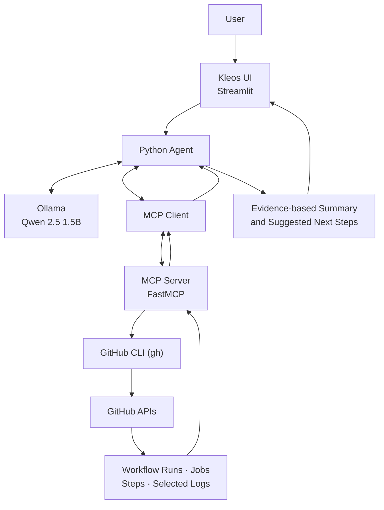

<div align="center">


# K L E O S

### AI-Powered DevOps Chatbot Assistant

<p>
  
  
  
  
  
  
  
</p>

**Local AI • Workflow Monitoring • Log Investigation • MCP Tool Calling**

[Features](#-features) · [Architecture](#-architecture) · [Tech Stack](#-technology-stack) · [Setup](#-getting-started) · [Examples](#-example-prompts)

</div>

---

## 🌌 Overview

**Kleos** is an AI-powered DevOps assistant that uses a local language model and MCP tools to inspect GitHub Actions workflows, investigate job results, review selected log findings, and explore repository files—all through a Streamlit interface.

> **Status:** Active development. Tool coverage and response quality are being improved continuously.

## ✨ Features

- **Workflow monitoring** — View recent GitHub Actions runs and their conclusions.
- **Job and step investigation** — Inspect job status and individual step outcomes.
- **Log findings** — Surface selected errors and warnings from workflow logs.
- **AI-assisted troubleshooting** — Turn tool output into explanations and next steps.
- **Repository inspection** — Read a remote repository's file tree and selected configuration files.
- **MCP tool calling** — Discover and invoke Python tools through the Model Context Protocol.
- **Local LLM** — Run Qwen 2.5 1.5B through Ollama.
- **Read-only workflow** — Designed for investigation, not automatic remediation.

## 🖥️ Interface

| Workspace | Purpose |
|---|---|
| **Chat** | Ask DevOps questions and start investigations. |
| **GitHub Actions** | Explore workflow runs and CI/CD results. |
| **Project Insights** | Review project-related information surfaced by the app. |
| **Settings** | Access application configuration. |
| **Recent Tool Activity** | See which MCP tools ran. |
| **Assistant Status** | Check model, MCP availability, access mode, and connected repository. |

## 🧰 Technology Stack

| Technology | Role |
|:--|:--|
| Python | Agent logic and MCP tools |
| Streamlit | Web interface |
| Ollama | Local model runtime |
| Qwen 2.5 1.5B | Language model |
| MCP Python SDK | Tool discovery and invocation |
| GitHub CLI / Actions | Workflow and repository data |
| Requests | HTTP calls to Ollama API |

## 🏗️ Architecture



### Request lifecycle

1. The user asks a question in the chat interface.
2. The agent sends the conversation and tool definitions to Ollama.
3. The model requests an MCP tool when GitHub data is needed.
4. The MCP server retrieves the relevant data through read-only GitHub CLI/API calls.
5. The result returns to the model, which generates a response for the UI.

## 🔌 MCP Tools

| Tool | Purpose |
|---|---|
| `list_project_files` | Lists files in the local Kleos project. |
| `get_project_info` | Returns basic information about the local project directory. |
| `get_github_workflow_runs` | Retrieves recent runs from `tanahmeeedsx/devsecops-agent`. |
| `get_github_run_jobs` | Reads job and step results for a run ID. |
| `get_github_job_log_findings` | Returns selected, classified log findings. |
| `investigate_github_actions_run` | Combines run, job, and log data into an investigation summary. |
| `inspect_github_repository` | Reads a repository file tree and selected configuration files. |

*Local project tools inspect Kleos itself; GitHub tools inspect the configured remote repository.*

## ⚙️ Getting Started

### Prerequisites

- Python 3.12+
- [Ollama](https://ollama.com/)
- [GitHub CLI](https://cli.github.com/)
- Read access to the configured GitHub repository

### 1. Clone

```bash
git clone https://github.com/tanahmeeedsx/LLM-chatbot-assistant.git
cd LLM-chatbot-assistant
```

### 2. Create a virtual environment and install dependencies

```bash
python -m venv .venv
source .venv/bin/activate
pip install -r requirements.txt
```

### 3. Start the local model and authenticate GitHub CLI

```bash
ollama pull qwen2.5:1.5b
gh auth login
gh auth status
```

### 4. Launch the interface

```bash
streamlit run app.py
```

Open the local URL printed by Streamlit (typically `http://localhost:8501`).

> The project is actively evolving. Confirm the entry-point and dependency files in your checkout if your local version differs.

## 💬 Example Prompts

**Check workflow status**
```text
Show the latest 5 GitHub Actions runs for tanahmeeedsx/devsecops-agent, including status and conclusion.
```

**Investigate a run**
```text
Investigate run <RUN_ID>. Review failed jobs and relevant log findings, then suggest fixes. Do not rerun workflows.
```

**Inspect repository files**
```text
Inspect tanahmeeedsx/devsecops-agent. Summarize its structure, technologies, Docker setup, and CI/CD configuration using the repository inspection tool.
```

## 🧠 Challenges & Learnings

| Challenge | What I learned |
|---|---|
| Connecting a local LLM to live DevOps data | MCP makes focused tools available to the model. |
| Making tool use visible | Recent tool activity helps show which tools actually ran. |
| Avoiding confusion between local and remote files | Dedicated tools are needed for local project info and remote repository inspection. |
| Separating errors from warnings | Log patterns need context and should not be treated as definitive root cause by themselves. |
| Working with a small model | Explicit tool instructions help, but results still need validation. |
| Keeping investigations safe | Read-only access avoids accidental workflow reruns and repository changes. |

## 🔐 Security & Limitations

- Investigation tools are intended for read-only access; they do not rerun workflows, create commits, deploy applications, or change cloud resources.
- Available data depends on the authenticated GitHub CLI account's permissions.
- Log findings use selected annotations and patterns; they are not a complete log review or guaranteed root-cause diagnosis.
- A small local model may select an unsuitable tool or summarize results incompletely. Verify important claims against tool output.
- Never commit tokens, credentials, or private environment files.

## 🛣️ Roadmap

- Improve tool selection and multi-step investigation reliability.
- Strengthen evidence-grounded summaries and log classification.
- Expand repository-aware analysis.
- Add automated tests and clearer error reporting.
- Continue improving the interface and developer experience.

## 🤝 Contributing

Suggestions and bug reports are welcome. Include expected behavior, actual behavior, and sanitized logs—never secrets or access tokens.

## 👨‍💻 Connect

**Tanjim Ahmed (Tomal)**

- GitHub: [@tanahmeeedsx](https://github.com/tanahmeeedsx)
- LinkedIn: [linkedin.com/in/tanahmedd](https://www.linkedin.com/in/tanahmedd)

---

<div align="center">

**KLEOS — Making DevOps investigation clearer, faster, and more actionable.**

</div>
