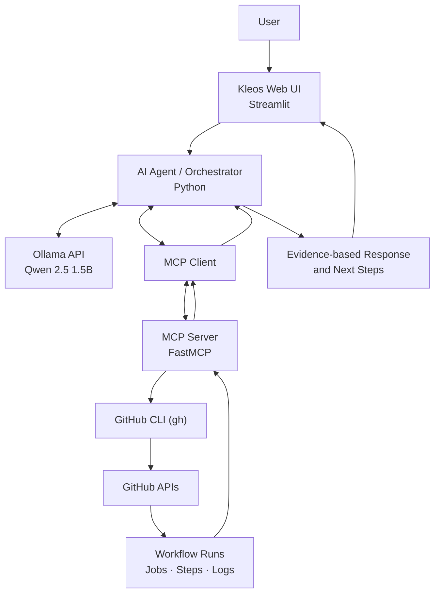

<div align="center">

# ⚡ KLEOS AI-Powered DevOps Chatbot Assistant

### Meet **Kleos** — your AI assistant for DevOps investigation

A local-LLM-powered DevOps assistant that connects natural-language questions with real GitHub Actions data through the **Model Context Protocol (MCP)**. Inspect workflow runs, review job and step results, analyze selected log findings, and explore a connected repository—all through one interface.

<p>
  
  
  
  
  
  
  
</p>

**Local AI · Tool calling · Workflow monitoring · Log investigation · Repository inspection**

</div>

---

## 📚 Table of Contents

- [Overview](#-overview)
- [Features](#-features)
- [Interface](#-interface)
- [Technology Stack](#-technology-stack)
- [Architecture](#-architecture)
- [MCP Tools](#-mcp-tools)
- [How It Works](#-how-it-works)
- [Getting Started](#-getting-started)
- [Example Prompts](#-example-prompts)
- [Challenges and Learnings](#-challenges-and-learnings)
- [Security and Limitations](#-security-and-limitations)
- [Roadmap](#-roadmap)
- [Connect](#-connect)

## 🎯 Overview

**Kleos** is an AI-powered DevOps chatbot assistant built to make CI/CD investigation more accessible through natural language. It uses **Qwen 2.5 1.5B through Ollama** and exposes Python-based tools through an **MCP server**. GitHub CLI (`gh`) provides authenticated access to GitHub Actions workflow data.

Instead of relying only on a model's general knowledge, Kleos can call tools, inspect returned evidence, and summarize workflow status, jobs, steps, and selected log findings. It also includes a read-only tool for examining the file tree and selected configuration files of the connected DevSecOps Agent repository.

> **Project status:** Active development. Tool coverage, response quality, and repository-analysis behavior continue to improve.

## ✨ Features

- **GitHub Actions monitoring** — Retrieve recent workflow runs and their status and conclusion.
- **Job and step inspection** — Review job results and step-level outcomes for a workflow run.
- **Log findings** — Extract selected errors and warnings from GitHub Actions job logs.
- **AI-assisted investigation** — Turn tool results into concise explanations and practical troubleshooting suggestions.
- **Repository inspection** — Read the connected repository's file tree and selected documentation/configuration files.
- **MCP tool integration** — Let the model discover and call available tools through the MCP client/server flow.
- **Local LLM inference** — Run Qwen 2.5 1.5B through Ollama.
- **Read-only investigation** — The intended workflow is inspection and analysis, not automatic remediation.
- **Developer-focused interface** — Chat, GitHub Actions, Project Insights, and Settings sections.

## 🖥️ Interface

| Section | Purpose |
|---|---|
| **Chat** | Ask DevOps questions and request tool-assisted investigation. |
| **GitHub Actions** | Focus on workflow history and CI/CD investigation. |
| **Project Insights** | View project-related information surfaced by the app. |
| **Settings** | Access application settings and configuration. |
| **Recent Tool Activity** | See which MCP tools ran during an assistant response. |
| **Assistant Status** | View the configured local model, MCP availability, access mode, and connected repository. |

## 🧰 Technology Stack

| Technology | Role |
|---|---|
| **Python** | Application, agent orchestration, and MCP tools |
| **Streamlit** | Interactive web interface |
| **Ollama** | Local model runtime and chat API |
| **Qwen 2.5 1.5B** | Language understanding, response generation, and tool selection |
| **Model Context Protocol (MCP)** | Standard interface between the assistant and Python tools |
| **MCP Python SDK** | MCP client/server implementation |
| **GitHub CLI (`gh`)** | Authenticated read access to GitHub Actions data |
| **GitHub Actions API** | Workflow runs, jobs, steps, and log data |
| **Requests** | HTTP communication with the local Ollama API |

## 🏗️ Architecture



### Request flow

1. The user asks a question in natural language.
2. The agent sends the conversation and available tool definitions to Ollama.
3. The model selects an MCP tool when external data is needed.
4. The MCP client invokes the tool on the Python MCP server.
5. The server uses read-only GitHub CLI/API requests to retrieve data.
6. Tool results return to the model, which prepares a response for the interface.
7. Recent tool activity helps the user see which tool was invoked.

## 🔌 MCP Tools

| Tool | What it does |
|---|---|
| `list_project_files` | Lists files and folders in the local Kleos project. |
| `get_project_info` | Returns basic information about the local project directory. |
| `get_github_workflow_runs` | Retrieves recent GitHub Actions runs for `tanahmeeedsx/devsecops-agent`. |
| `get_github_run_jobs` | Reads jobs and step outcomes for a specified run ID. |
| `get_github_job_log_findings` | Returns a limited, classified set of log errors and warnings. |
| `investigate_github_actions_run` | Combines run, job, and selected log information into an investigation summary. |
| `inspect_github_repository` | Reads the connected repository's file tree and selected documentation/configuration files. |

Tool availability can evolve as the project develops. Local-project tools inspect Kleos itself; GitHub tools inspect the configured remote repository. These are separate scopes.

## ⚙️ How It Works

### 1. Local model

Ollama serves `qwen2.5:1.5b` locally. The agent sends chat messages and tool schemas to the Ollama chat API.

### 2. Tool discovery and calling

At startup, the MCP client connects to the server over standard input/output (stdio), initializes a session, and retrieves the available tools. Tool definitions are converted into the format expected by Ollama. When the model requests a tool, the agent calls it through MCP and sends the result back into the conversation.

### 3. GitHub investigation

The GitHub tools use `gh` commands and GitHub API endpoints to retrieve workflow information. The investigation logic looks for relevant annotations and log patterns, then returns findings for the model to explain.

### 4. Evidence-first responses

Kleos is designed to explain what the tool output actually shows, distinguish warnings from confirmed failures, and avoid claiming that a tool ran when its result does not confirm it.

## 🚀 Getting Started

### Prerequisites

- Python 3.12 or newer
- [Ollama](https://ollama.com/) installed and running
- [GitHub CLI](https://cli.github.com/) installed and authenticated
- Access to the GitHub repository you want to inspect

### 1. Clone the repository

```bash
git clone https://github.com/tanahmeeedsx/LLM-chatbot-assistant.git
cd LLM-chatbot-assistant
```

### 2. Create and activate a virtual environment

```bash
python -m venv .venv
source .venv/bin/activate
```

### 3. Install project dependencies

```bash
pip install -r requirements.txt
```

If the local UI environment uses additional packages not yet listed in `requirements.txt`, install those project dependencies as needed.

### 4. Pull the local model

```bash
ollama pull qwen2.5:1.5b
```

Confirm Ollama is available:

```bash
ollama list
```

### 5. Authenticate GitHub CLI

```bash
gh auth login
gh auth status
```

The configured GitHub tools target `tanahmeeedsx/devsecops-agent`. Ensure the authenticated account can read that repository and its workflow data.

### 6. Start Kleos

Run the Streamlit entry point configured for your checkout. For the current local UI setup, this is:

```bash
streamlit run app.py
```

Then open the local URL shown in the terminal, usually `http://localhost:8501`.

> **Note:** The UI and dependencies are actively evolving. If the entry-point filename or required packages differ in your checkout, use the current local project configuration.

## 💬 Example Prompts

**Check workflow status**
```text
Show the latest 5 GitHub Actions workflow runs for my DevSecOps Agent repository, including status and conclusion.
```

**Investigate a failed run**
```text
Investigate GitHub Actions run <RUN_ID>. Inspect failed jobs and relevant log findings, then suggest practical fixes. Do not rerun the workflow.
```

**Inspect the repository**
```text
Inspect tanahmeeedsx/devsecops-agent. Summarize its project structure, main technologies, and key Docker and CI/CD configuration files using the repository inspection tool.
```

**Explain a log finding**
```text
Review the available findings for job <JOB_ID>. Separate actionable errors from warnings and explain what the evidence supports.
```

## 🧩 Challenges and Learnings

| Challenge | Approach / Learning |
|---|---|
| Connecting a local LLM to external DevOps data | Used MCP to expose focused Python functions as callable tools. |
| Making tool execution visible | Added recent tool activity so users can see which MCP tool was called. |
| Separating local project data from remote repository data | Added a dedicated repository inspection tool rather than treating local file listings as remote files. |
| Distinguishing errors from warnings | Classifies selected GitHub Actions annotations and log patterns and returns findings with context. |
| Handling small-model tool selection | Clear, specific prompts and explicit tool-selection rules help; responses still need validation against actual tool output. |
| Avoiding unintended changes during investigation | Focused the workflow on read-only inspection and troubleshooting recommendations. |

## 🔐 Security and Limitations

- The investigation tools are designed for **read-only** inspection; they do not rerun workflows, create commits, deploy applications, or modify cloud resources.
- GitHub access depends on the permissions of the authenticated `gh` account.
- Log findings are based on selected annotations and patterns; they are not a complete security audit or guaranteed root-cause diagnosis.
- A small local model may sometimes choose the wrong tool, ask unnecessary clarification questions, or summarize retrieved data incompletely. Verify important conclusions against the returned evidence.
- Never commit access tokens, credentials, or private configuration files to the repository.

## 🛣️ Roadmap

- Improve tool selection and multi-step investigation reliability.
- Improve evidence-grounded summaries and error/warning classification.
- Expand repository-aware context and configuration analysis.
- Add automated tests for MCP tools and response handling.
- Improve observability, failure messages, and setup documentation.
- Continue refining the interface and developer experience.

## 🤝 Contributing

Ideas, bug reports, and suggestions are welcome. Please open an issue with the expected behavior, actual behavior, and relevant sanitized logs. Never include credentials or secrets in an issue.

## 👨‍💻 Connect

**Tanjim Ahmed (Tomal)**

- GitHub: [@tanahmeeedsx](https://github.com/tanahmeeedsx)
- LinkedIn: [linkedin.com/in/tanahmedd](https://www.linkedin.com/in/tanahmedd)

---

<div align="center">

**Built to make DevOps investigation more observable, understandable, and actionable.**

</div>
